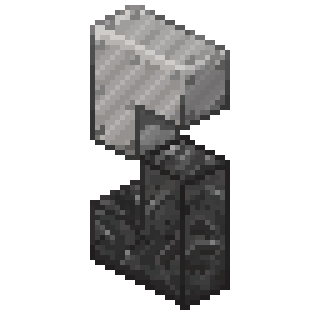

# AethelxSteelMC

A SteelMC Minecraft Java Edition server codebase: the full [SteelMC](https://steelmc.dev) source vendored from upstream, plus a ready-to-run server template (launch scripts, config, Playit tunnel). The server binary is **built by GitHub Actions** — no local Rust toolchain needed.

Vendored version: **0.15.4+mc26.2** (upstream [`Steel-Foundation/SteelMC`](https://github.com/Steel-Foundation/SteelMC) `master`).

## Quick start

```bash
./fetch-binary.sh   # download the steel-linux binary (CI artifact or upstream release)
./start 4G          # launch the server (RAM argument is informational)
./stop              # stop: ./stop {stop|restart|status}
./log               # tail the latest server log
```

No Java/JVM required — SteelMC is a native Rust binary.

## Getting the binary

The 45MB binary is no longer committed to git. Options:

1. **CI artifact (recommended)** — Actions → *Build* → latest green run → `steel-linux` artifact, or just `./fetch-binary.sh` (uses the `gh` CLI).
2. **Upstream release** — [SteelMC releases](https://github.com/Steel-Foundation/SteelMC/releases) (`steel-linux` asset); `./fetch-binary.sh` falls back to this automatically.
3. **From source** — `cargo build --release -p steel --features stand-alone,deadlock_detection` with the pinned nightly toolchain from `rust-toolchain.toml` (CI does this for every push to `main`).

## Repository layout

| Path | What it is |
|------|------------|
| `steel/`, `steel-core/`, `steel-protocol/`, … | SteelMC workspace crates (vendored, AGPL-3.0) |
| `start`, `stop`, `log` | Server lifecycle scripts |
| `config/` | Server configuration (`config.toml`, `worlds.toml`, `groups.toml`, favicon) |
| `setup-playit`, `playit.conf.example` | Public tunnel setup for Minecraft Java Edition |
| `.github/workflows/` | `build.yml` (this repo), plus upstream `test.yml` / `lint.yml` |
| `fetch-binary.sh` | Download a prebuilt `steel-linux` |
| `sync-upstream.sh` | Merge latest upstream SteelMC into this repo |

## Playit tunnel

```bash
cp playit.conf.example playit.conf
./setup-playit
```

Approve the one-time browser claim link, then create a TCP tunnel to local port `25565` in the Playit dashboard. Keep `playit.conf` and `.playit/` private — they are gitignored.

## Updating the vendored SteelMC source

```bash
./sync-upstream.sh        # git fetch + merge upstream master
./sync-upstream.sh develop # or another branch
```

Resolve any conflicts (usually only `README.md`, `LICENSE`, `.gitignore`), commit, push — CI rebuilds and tests everything.

## Configuration

Edit `config/config.toml` (`server_port`, `max_players`, `motd`, `online_mode`, `view_distance`, `simulation_distance`, …). See the [SteelMC configuration docs](https://steelmc.dev/configuration/server-configuration/).

## Notes

- Pre-alpha software — expect bugs and incomplete vanilla mechanics. Survival gameplay, most entity behavior, and plugins are not implemented yet. Track progress on the [implementation tracker](https://steelmc.dev/tracker).
- Paper/Bukkit/Fabric/Forge plugins do **not** work.
- Upstream project: [github.com/Steel-Foundation/SteelMC](https://github.com/Steel-Foundation/SteelMC) · Docs: [steelmc.dev](https://steelmc.dev) · Discord: [discord.gg/suSXXNdVSf](https://discord.gg/suSXXNdVSf)
- Local dev conveniences: AGENTS.md, CONTRIBUTING.md, Dockerfile, Nix flake — all from upstream.

## License

[AGPL-3.0-or-later](LICENSE) — the same license as upstream SteelMC. (The original binary-only template was MIT; vendoring the AGPL source relicenses the repository.)
